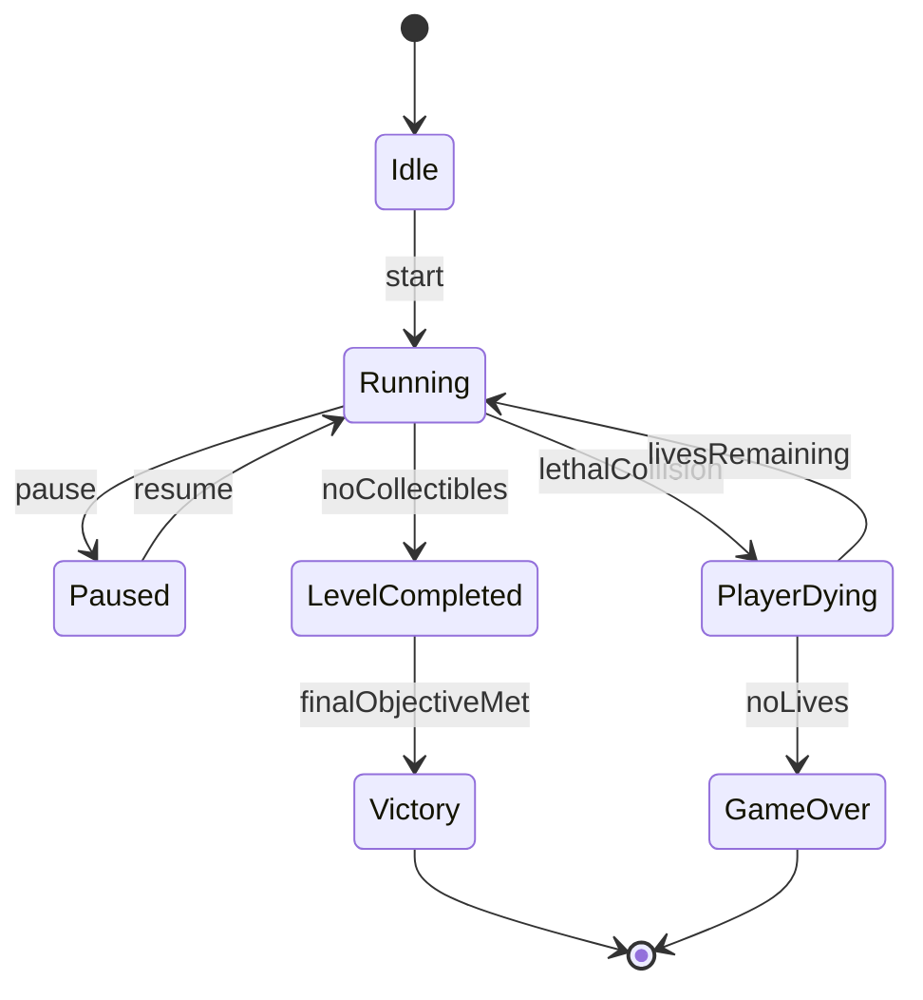
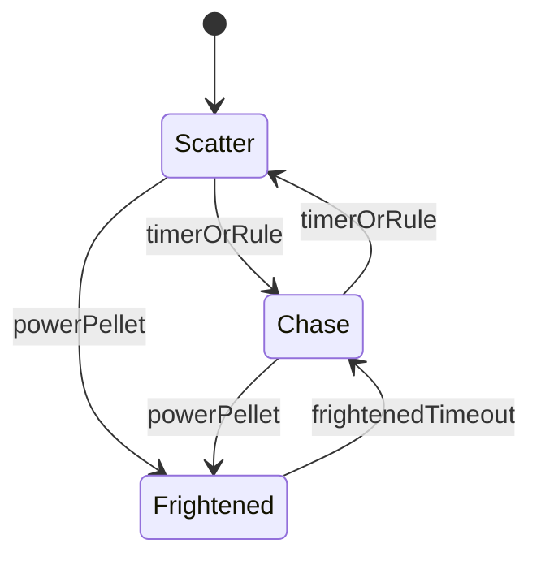
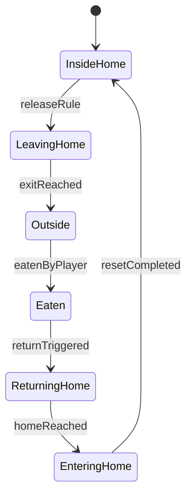
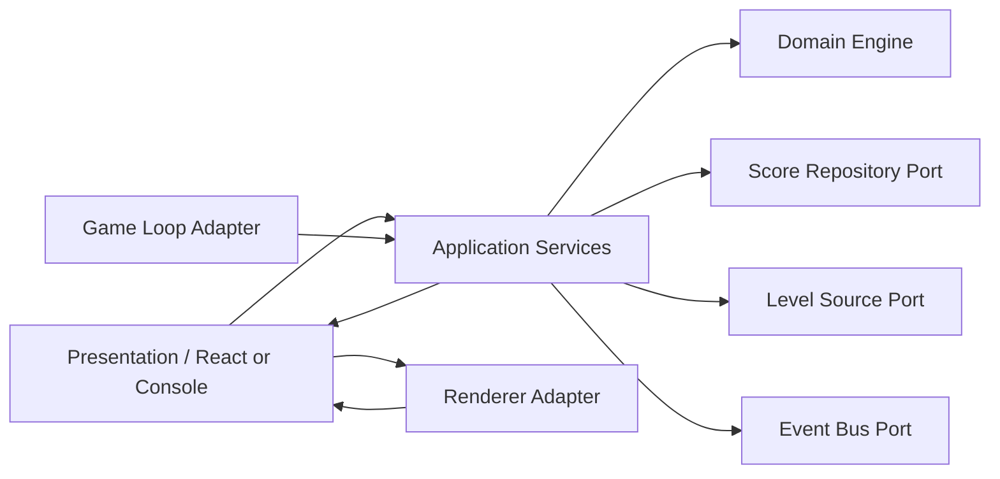
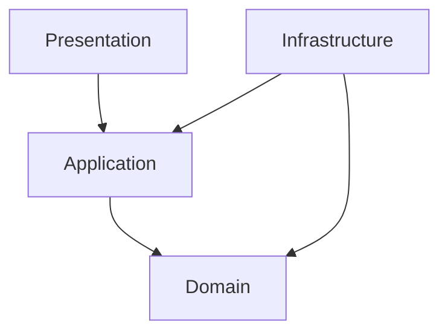

# Arquitectura Inicial del Proyecto Pac-Man-like

## 1. Analisis del dominio

### Problema central

El sistema modela un juego de persecucion en un laberinto sobre una grilla. El jugador y los enemigos se mueven bajo reglas discretas de navegacion, pero la simulacion debe admitir movimiento fluido y determinista.

### Subdominios principales

- Navegacion en tablero
- Simulacion de movimiento
- Recoleccion y puntuacion
- Colisiones
- Estados de partida
- Estados y decisiones de enemigos
- Publicacion de eventos

### Invariantes del dominio

- Ninguna entidad atraviesa paredes.
- La simulacion solo avanza cuando la partida esta en `Running`.
- Un consumible solo puede recolectarse una vez.
- La puntuacion cambia solo por reglas del dominio.
- Las vidas nunca pueden ser negativas.
- Las transiciones de estado invalidas deben ser rechazadas.
- Las estrategias de enemigos no pueden elegir direcciones bloqueadas.

## 2. Requisitos funcionales

- Crear una partida a partir de un nivel declarativo.
- Iniciar, pausar, reanudar y reiniciar la partida.
- Solicitar direccion del jugador.
- Avanzar la simulacion con un `fixed timestep`.
- Mover al jugador respetando direccion actual y direccion solicitada.
- Detectar recoleccion de dots y power pellets.
- Actualizar score y vidas.
- Detectar victoria cuando no quedan consumibles.
- Detectar derrota cuando no quedan vidas.
- Mover enemigos con estrategias intercambiables.
- Exponer snapshots serializables para cualquier adaptador visual.
- Emitir eventos de dominio y de aplicacion relevantes.

## 3. Requisitos no funcionales

- Determinismo en la simulacion.
- Independencia de framework y renderizador.
- Alta testeabilidad de la logica central.
- Bajo acoplamiento entre capas.
- Escalabilidad para nuevos mapas, enemigos y adaptadores.
- Estado de salida inmutable o tratable como solo lectura.
- Nombres y contratos faciles de defender en entrevista tecnica.

## 4. Restricciones arquitectonicas

- `domain` no importa nada de `application`, `infrastructure` ni `presentation`.
- `application` coordina casos de uso y puertos, pero no conoce implementaciones concretas.
- `infrastructure` implementa puertos definidos hacia adentro.
- `presentation` traduce inputs a comandos y snapshots a UI.
- Ningun componente visual contiene reglas nucleares del juego.
- El game loop no contiene reglas de negocio.
- Los sonidos y efectos visuales reaccionan a eventos; no gobiernan el dominio.

## 5. Modelo del dominio

### Entidades

- `GameState`: agregado raiz de la simulacion.
- `Board`: topologia del nivel y reglas de navegacion por tile.
- `Player`: entidad movil controlada por comandos.
- `Enemy`: entidad movil controlada por estrategia y estado.
- `Collectible`: dot o power pellet activo dentro del tablero.

### Value Objects

- `TilePosition`
- `WorldPosition`
- `Direction`
- `Velocity`
- `DurationMs`
- `ScoreValue`
- `LivesValue`
- `GameStatus`
- `EnemyBehaviorMode`
- `EnemyNavigationState`

### Servicios de dominio

- `MovementRules`
- `CollisionDetector`
- `CollectibleResolver`
- `EnemyDecisionPolicy`
- `VictoryEvaluator`

### Eventos de dominio

- `DotCollected`
- `PowerPelletCollected`
- `EnemyModeChanged`
- `EnemyEaten`
- `EnemyCollision`
- `PlayerDied`
- `LifeLost`
- `ScoreUpdated`
- `LevelCompleted`
- `GameOver`
- `GameWon`

### Eventos de aplicacion

- `GameCreated`
- `GameStarted`
- `GamePaused`
- `GameResumed`
- `GameRestarted`
- `TickCompleted`
- `PlayerDirectionRequested`

## 6. Casos de uso

- `createGame`
- `startGame`
- `pauseGame`
- `resumeGame`
- `restartGame`
- `requestPlayerDirection`
- `advanceSimulation`
- `getSnapshot`

## 7. Decisiones arquitectonicas principales

### Decision: simulacion con fixed timestep

- Problema: un render variable produce simulaciones no deterministas.
- Opciones consideradas: timestep variable, timestep fijo, timestep fijo con acumulador.
- Decision tomada: timestep fijo con acumulador en un runner externo.
- Justificacion: hace repetible el comportamiento y permite tests robustos.
- Ventajas: determinismo, claridad del dominio, independencia de `requestAnimationFrame`.
- Desventajas: requiere manejar atraso acumulado y posible interpolacion visual.
- Consecuencias futuras: facilita mover el motor a Node.js, Web Worker o replay system.

### Decision: dos maquinas de estado para enemigos

- Problema: el enemigo tiene condicion estrategica y condicion fisica distintas.
- Opciones consideradas: una sola FSM combinada, FSM jerarquica, dos FSM separadas.
- Decision tomada: dos FSM separadas con reglas de sincronizacion.
- Justificacion: reduce explosion combinatoria y hace visible cada eje de cambio.
- Ventajas: extensibilidad y mejor explicacion en entrevista.
- Desventajas: exige coordinar coherencia entre estados.
- Consecuencias futuras: se podra evolucionar a FSM jerarquica si la complejidad crece.

### Decision: Strategy solo para la eleccion de direccion

- Problema: los enemigos requieren comportamientos distintos sin acoplarse al juego entero.
- Opciones consideradas: `switch` gigante, reglas hardcodeadas en entidad, Strategy.
- Decision tomada: `Strategy` para calcular decision a partir de un contexto acotado.
- Justificacion: aisla variaciones de comportamiento sin exponer estado mutable global.
- Ventajas: pruebas unitarias directas y extension segura.
- Desventajas: mas tipos y contratos iniciales.
- Consecuencias futuras: permite introducir `Chase`, `Patrol`, `Flee` y variantes sin reescribir la entidad.

### Decision: snapshots serializables como contrato de salida

- Problema: la UI necesita leer el estado sin mutarlo.
- Opciones consideradas: exponer entidades, exponer DTO snapshot, exponer selectores ad hoc.
- Decision tomada: snapshot serializable inmutable por tick.
- Justificacion: evita acoplamiento accidental entre UI y dominio.
- Ventajas: portabilidad y seguridad.
- Desventajas: requiere traduccion de entidades a snapshot.
- Consecuencias futuras: facilita debug overlays, replay, consola y telemetria.

## 8. Colisiones

Se usara una combinacion de tecnicas:

- tiles para paredes y consumibles
- posicion continua para movimiento fluido
- comparacion de trayectoria entre ticks para cruce jugador-enemigo
- reglas topologicas para tuneles

Esto conserva coherencia con una grilla sin obligar a que toda la simulacion sea puramente por saltos de tile.

## 9. Maquina de estados de la partida

## 10. Maquina de estados de enemigos

### Modo estrategico

### Estado fisico

## 11. Diagrama de componentes

## 12. Diagrama de dependencias

Regla:

- nunca `Domain --> Application`
- nunca `Domain --> Infrastructure`
- nunca `Application --> Presentation`

## 13. Riesgos tecnicos

- Mezclar coordenadas logicas y visuales demasiado pronto.
- Introducir logica de negocio en el adaptador visual.
- Diseñar demasiadas abstracciones antes de validar el dominio.
- Modelar enemigos con estados acoplados y dificiles de probar.
- Resolver colisiones solo por tile e ignorar cruces entre ticks.
- Crear un event bus que opaque el flujo de control.

## 14. Roadmap de implementacion

### Fase 1. Tablero

- Objetivo: modelar el nivel, tiles y movimientos validos.
- Aprendizaje: value objects, invariantes, modelado de topologia.
- Entregable base:
  - `LevelDefinition` declarativo
  - `createBoard`
  - `createBoardQuery`
  - consultas de walkability, intersecciones y tuneles
  - tests de parsing y navegacion

### Fase 2. Jugador

- Objetivo: movimiento por ticks con direccion actual y solicitada.
- Aprendizaje: movimiento desacoplado de input fisico.
- Entregable base:
  - `createPlayer`
  - `requestPlayerDirection`
  - `advancePlayer`
  - conversion `TilePosition <-> WorldPosition`
  - preview de consola para validar snapshots temprano

### Fase 3. Recoleccion y score

- Objetivo: dots, pellets, score y victoria.
- Aprendizaje: eventos de dominio y reglas centralizadas.
- Entregable base:
  - creacion de collectibles desde el nivel
  - recoleccion idempotente por tile
  - aumento de score por configuracion
  - paso a `LevelCompleted` al agotar collectibles
  - demo de consola con score y progreso visible

### Fase 4. Primer enemigo

- Objetivo: entidad enemigo, movimiento valido y colision basica.
- Aprendizaje: navegacion y entidades con comportamiento.
- Entregable base:
  - `createEnemy` y creacion de enemigos desde spawns
  - avance de enemigo con movimiento valido sobre la grilla
  - estrategia aleatoria minima desacoplada del render
  - colision jugador-enemigo por misma celda y cruce entre ticks
  - demo de consola mostrando persecucion basica

### Fase 5. Estrategias

- Objetivo: `Random`, `Chase`, `Patrol`, `Flee`.
- Aprendizaje: Strategy y contextos de decision.
- Entregable base:
  - estrategias separadas del movimiento fisico
  - contexto inmutable y acotado para decidir direccion
  - `Random`, `Chase`, `Patrol` y `Flee`
  - asignacion de estrategia por enemigo
  - demo de consola con roles visibles por enemigo

### Fase 6. Estados completos

- Objetivo: pausa, muerte, restart, game over, victory y estados enemigos.
- Aprendizaje: maquinas de estado y transiciones invalidas.
- Entregable base:
  - `pause`, `resume` y `restart` explicitos
  - resolucion temporal de `playerDying`
  - paso de `levelCompleted` a `victory`
  - rechazo practico de avances invalidos en `idle`, `paused`, `gameOver` y `victory`
  - demo de consola mostrando el ciclo de vida de la partida

### Fase 7. Adaptador visual

- Objetivo: input, renderer y loop visual conectados por puertos.
- Aprendizaje: ports and adapters en frontend real.
- Entregable base:
  - renderer visual desacoplado del dominio
  - loop visual con `requestAnimationFrame` y fixed timestep en el adaptador
  - captura de teclado traducida a comandos
  - snapshot interpolation solo en presentacion
  - demo jugable en navegador para comparar con el comportamiento clasico

### Fase 8. Calidad y escalabilidad

- Objetivo: integracion, persistencia, documentacion final y preparacion de entrevista.
- Aprendizaje: tradeoffs, extensibilidad y defensa arquitectonica.
- Entregable base:
  - persistencia local de score mediante adapter de infraestructura
  - overlay de debug activable sin contaminar el dominio
  - ranking visible en el adaptador visual
  - tests adicionales de infraestructura
  - notas finales de escalabilidad y preparacion de entrevista

### Fase 9. Fidelidad arcade

- Objetivo: acercar el comportamiento del clon al Pac-Man clasico con `power pellets` funcionales.
- Aprendizaje: temporizadores superpuestos, colisiones contextuales y reglas de vulnerabilidad.
- Entregable base:
  - `frightened mode` determinista al recolectar `power pellet`
  - expiracion temporal desacoplada del render
  - colision no letal contra enemigos frightened con respawn simplificado
  - puntaje adicional por enemigo vulnerable
  - nivel demo con pellets visibles para validar parecido al arcade

### Fase 10. Enemigos comidos y score encadenado

- Objetivo: reemplazar el respawn instantaneo por un retorno visible al home tile y acercar la puntuacion al ritmo arcade.
- Aprendizaje: uso real del eje `navigationState` y reglas de combo dentro de una misma ventana temporal.
- Entregable base:
  - enemigos comidos pasando a `returningHome`
  - restauracion a `outside` al llegar al home tile
  - score encadenado `200/400/800/...` dentro del mismo frightened
  - glyph/visual diferenciada para enemigos que regresan a casa
  - tests focalizados para retorno y combo

### Fase 11. Ciclo global scatter/chase

- Objetivo: recuperar la sensacion de presion oscilante del arcade en lugar de dejar enemigos en un modo fijo.
- Aprendizaje: scheduler temporal de dominio, modos globales y suspension de timers durante estados prioritarios.
- Entregable base:
  - schedule declarativo de `scatter/chase`
  - countdown del modo global dentro de `GameState`
  - pausa del scheduler mientras `frightened` esta activo
  - snapshot y debug mostrando modo actual y tiempo restante
  - tests focalizados para cambio de modo y pausa temporal

### Fase 12. Salida escalonada de fantasmas

- Objetivo: evitar que todos los enemigos esten activos desde el primer tick y aproximar el ritmo clasico de presion.
- Aprendizaje: coordinacion entre `navigationState`, timers de aplicacion y activacion progresiva de entidades.
- Entregable base:
  - enemigos secundarios iniciando en `insideHome`
  - scheduler declarativo de liberacion por delays
  - activacion progresiva sin acoplar el dominio al render
  - snapshot/debug con tiempo restante para la siguiente salida
  - tests focalizados de espera y liberacion

### Fase 13. Salida visible desde casa

- Objetivo: evitar la sensacion de "teletransporte" al liberar fantasmas y acercar la puesta en escena al arcade.
- Aprendizaje: uso efectivo de `leavingHome` como estado navegable y no solo documental.
- Entregable base:
  - liberacion `insideHome -> leavingHome -> outside`
  - direccion inicial de salida orientada hacia la calle superior
  - transicion automatica a `outside` al alcanzar el carril de salida
  - diferenciacion visual en canvas y consola para el estado `leavingHome`
  - tests focalizados para salida parcial y salida completada

### Fase 14. Ghost house con topologia contextual

- Objetivo: representar la casa de fantasmas como parte real del tablero y no como decoracion sin reglas.
- Aprendizaje: el mismo tile no necesariamente es transitable por todos los actores; la topologia depende del rol de movimiento.
- Entregable base:
  - reglas de walkability separadas para jugador y enemigos
  - `ghostHouse` y `restricted` usadas en navegacion, no solo en render
  - enemigos `insideHome`, `leavingHome` y `returningHome` con acceso contextual a la casa
  - jugador y enemigos `outside` bloqueados por la puerta de la casa
  - nivel demo con ghost house visible para comparar mejor el parecido arcade

### Fase 15. Roster completo y roles mas legibles

- Objetivo: acercar la percepcion del clon al reparto clasico de cuatro fantasmas con personalidades diferenciadas.
- Aprendizaje: el contexto de decision puede crecer de forma controlada si se mantiene inmutable y orientado al dominio.
- Entregable base:
  - cuarto enemigo activo en el nivel demo
  - estrategia `ambush` basada en tiles por delante del jugador
  - asignacion explicita de roles `chase`, `ambush`, `patrol` y `vector`
  - corners de `scatter` diferenciados por fantasma
  - visualizacion/debug mostrando mejor el rol real de cada enemigo

## 15. Casos de prueba que deben quedar cubiertos mas adelante

- El jugador no atraviesa paredes.
- Si la direccion solicitada esta bloqueada, mantiene la actual si sigue disponible.
- Si ambas direcciones estan bloqueadas, se detiene.
- Los dots desaparecen una vez recolectados.
- El score aumenta segun configuracion.
- El power pellet activa `Frightened` por una duracion determinista.
- Se detecta colision por misma posicion y por cruce entre ticks.
- La partida rechaza transiciones invalidas.
- Los enemigos solo toman caminos validos.
- `pause` congela la simulacion.
- `restart` restaura el estado semilla.

## 16. Defensa de la arquitectura en entrevista

- El motor no depende de React porque React solo consume snapshots y emite comandos.
- El game loop no decide reglas; solo entrega tiempo a la aplicacion.
- La UI no mueve entidades; solicita intenciones.
- El dominio es testeable porque depende de tipos puros y puertos controlables.
- Los patrones usados tienen un costo justificado y local:
  - `Strategy` para comportamiento de enemigos
  - `Adapter` para tecnologias externas
  - `Repository` para score persistido
  - `Command` para entradas de usuario
  - FSM explicita para estados validos

## 17. Cierre de calidad y escalabilidad

### Persistencia

- El ranking de score queda resuelto mediante el puerto `ScoreRepository`.
- La fase 8 usa un adapter para navegador basado en `localStorage` y una variante en memoria para tests.
- La aplicacion y el dominio no conocen detalles de serializacion ni APIs del navegador.

### Observabilidad

- El adaptador visual expone un overlay de debug activable para inspeccionar `tick`, posicion, direccion y estado.
- La informacion de diagnostico se construye desde snapshots ya serializables.
- Esto permite defender que la observabilidad vive fuera de las reglas nucleares del juego.

### Escalabilidad futura

- Se puede reemplazar `localStorage` por backend, IndexedDB o sincronizacion remota sin tocar el dominio.
- El renderer actual de canvas puede migrar a React Canvas, PixiJS o Phaser manteniendo el mismo contrato de snapshot.
- El loop podria moverse a Web Worker o replay runner determinista sin reescribir reglas centrales.

## 18. Fase 9 implementada

- El estado `frightened` ahora depende de un timer explicito en `GameState`, no del adaptador visual.
- Los `power pellets` activan vulnerabilidad global de enemigos por una duracion determinista.
- La colision contra un enemigo frightened deja de costar vida y concede score extra con respawn simplificado al home tile.
- El demo del navegador ya contiene pellets visibles para comparar mejor el comportamiento con el referente arcade.

## 19. Fase 10 implementada

- Los enemigos comidos ya no reaparecen instantaneamente: entran en `returningHome` y vuelven por el tablero.
- La racha de frightened queda explicitada en el estado para soportar combos de score crecientes.
- Consola y canvas distinguen visualmente a los enemigos que estan regresando al home tile.

## 20. Fase 11 implementada

- El motor ahora alterna `scatter` y `chase` mediante un scheduler declarado en configuracion.
- El timer global no avanza mientras la ventana de `frightened` esta activa, preservando prioridad de reglas.
- El snapshot expone modo y tiempo restante para debug, entrevista y futuros overlays mas cercanos al arcade.

## 21. Fase 12 implementada

- Los fantasmas secundarios pueden comenzar dentro de casa y salir de forma escalonada.
- La salida usa delays configurables en aplicacion, manteniendo el dominio portable y testeable.
- El debug visual y la consola ahora dejan ver mejor el ritmo de activacion progresiva del nivel.

## 22. Fase 13 implementada

- La liberacion ya no activa enemigos directamente en `outside`: ahora pasan por `leavingHome`.
- El dominio calcula una salida vertical simple hasta el primer carril caminable por encima del spawn.
- El navegador y la consola distinguen ese estado intermedio para comparar mejor el ritmo visual con el Pac-Man clasico.

## 23. Fase 14 implementada

- El tablero ya diferencia rutas del jugador frente a rutas de enemigos segun su `navigationState`.
- La ghost house y su puerta restringida forman parte de la topologia real del nivel demo.
- El render del navegador deja visible esa estructura para facilitar comparacion visual con el referente original.

## 24. Fase 15 implementada

- El demo ya contiene cuatro fantasmas con liberacion progresiva desde la casa.
- El dominio incorpora una estrategia `ambush` simple usando la direccion actual del jugador.
- El snapshot y los adaptadores visuales distinguen mejor el rol de cada fantasma, facilitando comparacion con el reparto arcade.

## 25. Fase 16 implementada

- El canvas representa estados arcade sin contaminar el dominio: los power pellets parpadean y los fantasmas vulnerables alternan azul/blanco cerca del timeout.
- Las pupilas siguen la direccion publicada en el snapshot y los fantasmas que regresan a casa se renderizan solo como ojos.
- Estas animaciones usan el reloj de presentacion y son derivadas; la simulacion fija y sus tests permanecen deterministas.

## 26. Fase 17 implementada

- Al colisionar, jugador y enemigos permanecen congelados en la posicion de impacto durante `playerDying`; el reset del nivel sucede solo al finalizar el temporizador de respawn.
- El snapshot publica `phaseTimerMs` para que el adaptador canvas represente la muerte sin introducir temporizadores duplicados.
- El jugador cierra la boca y se reduce progresivamente en la posicion real de la colision, una transicion visual mas cercana al referente arcade.

## 27. Fase 18 implementada

- El mapa declarativo acepta el marcador `F` para crear un bonus fruit sobre una ruta caminable.
- El fruit se recolecta una sola vez, usa `fruitPoints` declarado en configuracion y no activa frightened.
- El objetivo de nivel sigue dependiendo solo de dots y power pellets; un fruit que permanezca en tablero no bloquea la victoria.

## 28. Fase 19 implementada

- La FSM incorpora el estado `ready`, que congela la simulacion antes del inicio de cada ronda y despues de un respawn.
- `readyDelayMs` es una configuracion opcional: el dominio conserva compatibilidad con `0` ms y el demo usa una pausa visible de 1.8 segundos.
- El canvas muestra `READY!` en amarillo sobre el tablero, acercando el flujo inicial al ritmo del arcade clasico.

## 29. Fase 20 implementada

- El cuarto fantasma del roster usa ahora la estrategia `vector`: persigue al jugador cuando esta lejos y se repliega a su esquina de scatter cuando se acerca a ocho tiles.
- La decision recibe solo el contexto inmutable ya disponible y conserva el contrato `EnemyMovementStrategy`.
- El canvas asigna colores reconocibles a los cuatro roles: rojo, rosa, cyan y naranja; la consola muestra `V` para el cuarto rol.

## 30. Fase 21 implementada

- El adaptador canvas compara snapshots fijos consecutivos para derivar popups de score en dots, pellets, fruit y fantasmas comidos.
- Los popups son estado efimero de presentacion con desplazamiento y desvanecimiento; no modifican el agregado ni el replay determinista.
- La puntuacion de enemigos respeta la racha frightened publicada en los snapshots para mostrar `200`, `400`, `800` y sucesivos valores.

## 31. Fase 22 implementada

- El HUD del adaptador visual muestra score actual, high score, estado y vidas en una sola franja de lectura rapida.
- El high score se deriva de la partida activa y del puerto `ScoreRepository`; no introduce persistencia en el dominio.
- Las vidas se representan como iconos de Pac-Man para acercar la interfaz al lenguaje visual del arcade.

## 32. Fase 23 implementada

- Los enemigos con navegacion `outside` invierten direccion de manera atomica al alternar entre scatter/chase o al comenzar frightened.
- La regla vive en dominio y se aplica antes del movimiento del tick, por lo que no depende del frame rate ni del renderer.
- Enemigos dentro, saliendo o retornando a la casa no invierten, preservando la topologia y la salida escalonada.

## 33. Fase 24 implementada

- La configuracion admite `extraLifeScore` para otorgar una vida al cruzar un umbral de score, una sola vez por sesion.
- El agregado conserva `extraLifeAwarded`, lo que hace idempotente la regla y permite reiniciarla correctamente al comenzar una partida nueva.
- El demo concede la vida extra a los 500 puntos y el HUD existente la representa automaticamente.

## 34. Fase 25 implementada

- `fruitSpawnAfterDots` permite diferir el bonus fruit hasta que el jugador haya recogido un numero configurado de dots o power pellets.
- Cada collectible expone `spawned`, distinguiendo un fruit pendiente de uno que ya fue recogido y evitando reapariciones.
- El demo activa su fruit tras seis consumibles; como siempre, el fruit no bloquea la finalizacion del nivel.

## 35. Fase 26 implementada

- `frightenedSpeedMultiplier` configura la velocidad temporal de los fantasmas vulnerables, con valor por defecto `1` para mantener compatibilidad.
- El multiplicador se entrega al movimiento por tick sin modificar la velocidad base almacenada en cada entidad.
- El demo usa `0.65`, haciendo visible que los fantasmas frightened son mas lentos y que recuperan su ritmo normal al terminar el timer.

## 36. Fase 27 implementada

- `fruitVisibleDurationMs` limita de forma determinista cuanto permanece visible cada aparicion del bonus fruit.
- Una expiracion no se confunde con una recoleccion, por lo que no suma puntos ni genera feedback visual.

## 37. Fase 28 implementada

- `fruitSpawnThresholds` permite declarar varias apariciones del mismo fruit por nivel, aproximando los dos bonus del arcade clasico.
- El collectible conserva `spawnCount`; cada umbral solo se puede activar una vez y no existen reapariciones ilimitadas.
- `fruitSpawnAfterDots` sigue funcionando como alias de compatibilidad para una sola aparicion.

## 38. Fase 29 implementada

- El snapshot publica `remainingMs` para que los adaptadores puedan informar el estado temporal de un collectible sin consultar el agregado mutable.
- Durante los dos ultimos segundos de una aparicion, el canvas hace parpadear el fruit con el reloj de presentacion.
- El parpadeo es una decision visual derivada: ni el tiempo de expiracion ni el resultado de la partida dependen del frame rate.

## 39. Fase 30 implementada

- `fruitPointsBySpawn` permite asignar una puntuacion por aparicion del bonus fruit, con fallback a `fruitPoints` para configuraciones existentes.
- Los puntos del collectible viajan en el snapshot, por lo que el popup muestra el valor realmente otorgado por el dominio.
- El demo usa 100 puntos en la primera aparicion y 300 en la segunda.

## 40. Fase 31 implementada

- El adaptador canvas mantiene un reloj de presentacion independiente del reloj real del navegador.
- En `Paused`, se congelan la boca del jugador, los parpadeos de collectibles y los popups de score, igual que la simulacion.
- Reiniciar una partida restablece tambien el reloj visual, sin introducir estado de presentacion en el dominio.

## 41. Correccion de controles

- `requestDirectionForSession` inicia la ronda desde `Idle` y conserva la primera direccion solicitada durante `Ready`.
- El navegador comunica que flechas y WASD inician la partida; ya no requiere conocer `Enter` como paso previo.
- Una prueba de aplicacion asegura que la primera direccion queda en buffer y mueve al jugador al terminar el delay de salida.

## 42. Correccion de movimiento entre ticks

- La validacion de movimiento conserva la celda de origen mientras el jugador avanza entre dos centros de tile.
- Esto evita detenerse en el borde de una celda cuya salida esta bloqueada antes de poder tomar un giro valido en su centro.
- Una regresion con ticks parciales cubre el avance, el giro y la continuacion por el nuevo pasillo.

## 43. Fase 32 implementada

- `enemyReleaseDotThresholds` permite liberar fantasmas secundarios al alcanzar progreso de dots, con el timer existente como respaldo.
- La regla se evalua despues de la recoleccion del tick, por lo que el dot que cruza el umbral produce una salida determinista inmediata.
- El demo usa umbrales 4, 10 y 18 para dar una presion progresiva mas cercana al ritmo arcade.

## 44. Fase 33 implementada

- El snapshot publica `pelletsCollected` y `pelletsTotal`, excluyendo fruit para reflejar el progreso real del nivel.
- El HUD operativo y el overlay de debug muestran ese progreso, permitiendo observar los umbrales que liberan fantasmas.
- Una prueba de aplicacion protege el contrato serializable y evita contar bonus fruit como pellet.

## 45. Fase 34 implementada

- `elroyStages` acelera al fantasma `chase` cuando los pellets restantes cruzan umbrales configurados.
- La velocidad base no se muta y `Frightened` mantiene prioridad, por lo que la aceleracion no contamina otros estados de navegacion.
- El demo usa multiplicadores 1.15x y 1.30x al quedar 20 y 10 pellets; el overlay publica el multiplicador activo.

## 46. Fase 35 implementada

- El demo de navegador usa ahora un laberinto declarativo de 21x19: cuatro spawns de fantasmas, casa central, pellets de poder y tunel lateral.
- La topologia sigue siendo responsabilidad de `Board`; Canvas solo renderiza los tiles que recibe y no codifica rutas especificas del mapa.
- Una prueba de nivel protege dimensiones, roster visible y conectividad del tunel para evitar regresiones visuales del escenario principal.

## 47. Fase 36 implementada

- Durante `levelCompleted`, el adaptador Canvas alterna las paredes del laberinto entre su color normal y blanco, y oculta actores y collectibles.
- El destello se calcula con el reloj de presentacion y el `GameStatus` publicado por el snapshot; la simulacion no conoce canvas, frames ni colores.
- Una prueba de presentacion fija el contrato de activacion y evita que el destello aparezca en estados como `running` o `victory`.

## 48. Fase 37 implementada

- `returningHomeSpeedMultiplier` acelera a los fantasmas en navegacion `returningHome`, sin mutar la velocidad base de la entidad.
- La prioridad del multiplicador evita que Elroy o `Frightened` modifiquen el retorno: ese trayecto tiene su propia regla de movimiento.
- El demo configura `1.55x` y una prueba de aplicacion compara el desplazamiento normal contra el acelerado.

## 49. Fase 38 implementada

- Objetivo e historia: como jugador, quiero ver a los fantasmas comidos regresar, recuperarse dentro de casa y salir de nuevo.
- Dominio: llegar al tile de origen cambia `returningHome` a `insideHome` y detiene el movimiento restante de ese tick.
- Aplicacion: programa `reentryReleaseTimerMs` con `returningHomeReleaseDelayMs` (1500 ms por defecto, cero permite salida inmediata). La espera comienza al final del tick de llegada; la precision queda limitada al timestep fijo.
- Al vencer la espera, `releaseEnemyFromHome` limpia el timer, entra en `leavingHome` y recupera el modo global vigente. Solo el tiempo sobrante del tick se usa para moverse.
- Presentacion: el snapshot expone el timer y el overlay lo muestra; Canvas dibuja el cuerpo dentro de casa a partir del estado publicado.
- Criterios y pruebas: llegada sin movimiento residual, espera determinista, pausa, reinicio, movimiento proporcional al tiempo sobrante y ausencia de puntos por colisiones con fantasmas dentro de casa.
- Problema y opciones: reutilizar el calendario inicial mezclaria la liberacion del roster con retornos independientes. Se elige un timer por enemigo, que permite varias recuperaciones simultaneas con un campo adicional en la entidad.
- Riesgo: un pellet nuevo durante el retorno no debe transformar los ojos en un fantasma comestible; los retornos conservan su modo y las colisiones comestibles exigen `outside`.
- Defensa en entrevista: el tiempo pertenece a la simulacion, mientras el renderer solo observa el snapshot. No se usan `setTimeout` ni relojes visuales para una regla de gameplay.
- Modulos: `domain/enemy.ts` y `entities.ts`, `application/game-session.ts` y `contracts.ts`, demo y overlay de presentacion.

## 50. Fase 39 implementada

- Objetivo e historia: como jugador, quiero que los fantasmas comidos encuentren la casa aunque necesiten alejarse de ella para rodear paredes.
- Problema: la distancia Manhattan local no considera obstaculos y puede provocar vueltas o recorridos innecesarios durante el regreso.
- Opciones: conservar el criterio voraz, usar BFS o introducir A*. Se elige BFS porque todas las conexiones del tablero tienen el mismo coste y el mapa actual es pequeno.
- Diseno: `domain/enemy-navigation.ts` recibe `BoardQuery`, origen, destino y estado de navegacion; devuelve la primera direccion de una ruta minima o `null` cuando no hay ruta.
- Las consultas del tablero conservan la autoridad sobre paredes, acceso a casa y conexiones laterales. La busqueda no accede al estado mutable de partida ni al renderer.
- `returningHome` y `leavingHome` usan la ruta en cada centro de celda. El retorno admite invertir direccion; los modos normales conservan sus estrategias y regla de no invertir.
- Criterios de aceptacion: desvio alrededor de paredes, uso de tuneles cuando acortan la ruta, acceso contextual a casa, desempate determinista y parada ante destinos inaccesibles. Si el fantasma ya esta en casa, se recupera antes de intentar otro movimiento.
- Tests: rutas puras y movimiento integrado; los cuatro fantasmas del demo regresan desde cuatro corredores distantes y vuelven a salir.
- Coste: O(V + E) por decision y memoria O(V). Se recalcula en centros de celda; mapas mayores podrian usar campos de distancia precalculados por destino y estado.
- Riesgos: los mapas desconectados detienen el regreso; esta fase no añade validacion global de conectividad. Los empates siguen el orden estable de direcciones del tablero.
- Pregunta de entrevista: por que BFS garantiza rutas minimas aqui y cuando seria adecuado A*? Defensa: costes uniformes, topologia centralizada y pruebas independientes de Canvas; las conexiones de tunel deben considerarse al definir una heuristica de A*.

## 51. Fase 40 implementada

- Objetivo e historia: como jugador, quiero moverme y controlar la partida desde una pantalla tactil o un raton sin necesitar teclado.
- Diseno: `infrastructure/browser-controls.ts` traduce activaciones de botones a callbacks tipados. Teclado y botones comparten comandos en `presentation/browser.ts`, que invocan los casos de uso existentes.
- Decisiones: botones HTML nativos con `click` en lugar de gestos o repeticion por pulsacion. La direccion solicitada ya queda almacenada por el dominio, por lo que no necesita eventos repetidos ni nuevos temporizadores.
- Accesibilidad: etiquetas para las direcciones, foco visible, objetivos tactiles de al menos 44px y estado `aria-pressed` para debug. Los botones deshabilitan Start y Pause cuando no aplican; Pause cambia a Resume durante la pausa.
- El atajo de debug cambia de Tab a G: Tab queda disponible para recorrer controles. Enter/Espacio sobre botones usan la activacion nativa sin ejecutar tambien el handler global.
- Responsive: altura automatica del canvas mantiene su proporcion; HUD de dos columnas y padding reducido a 560px o menos.
- Criterios: una direccion inicia y se almacena durante Ready; pausa/reanudacion funciona con boton o teclado; reinicio restaura partida y acumulador; comandos desconocidos se ignoran.
- Pruebas: traduccion de direcciones y comandos de ciclo de vida, suite completa y verificacion en navegador de inicio con cruceta, pausa, reanudacion con Espacio, reinicio y vista de 360px sin desbordamiento horizontal.
- Coste y riesgos: se añade un adaptador DOM y sus listeners deben retirarse al cerrar. Esta fase incorpora cruceta, no gestos de swipe; la experiencia tactil se basa en botones nativos.
- Defensa en entrevista: el dispositivo emite comandos, nunca cambia posiciones directamente; el dominio y sus pruebas permanecen independientes del DOM y del tamaño del canvas.

## 52. Fase 41 implementada

- Objetivo e historia: como jugador movil, quiero deslizar sobre el tablero para cambiar de direccion sin buscar los botones.
- Diseno: `infrastructure/swipe-input.ts` convierte Pointer Events de dedo o lapiz en el mismo callback `requestDirection` usado por la cruceta y el teclado. No mueve entidades directamente.
- Alternativas: eventos tactiles separados, gestos continuos o Pointer Events. Se eligen Pointer Events por su soporte de captura, cancelacion y lapices; se emite un comando al terminar el gesto para evitar repeticion accidental.
- Reglas del adaptador: minimo 24 pixeles CSS, eje dominante al menos 1.2 veces el otro, un solo puntero primario y coordenadas finitas. El umbral no depende del tamaño interno del canvas.
- Captura: el tablero retiene el puntero aunque salga de su area. `pointercancel` y `lostpointercapture` descartan el gesto; otro puntero no puede finalizarlo. Mouse conserva su comportamiento existente.
- Presentacion: `touch-action: none` se aplica solo al canvas. Al retirar el adaptador se libera la captura, se retiran listeners y se restaura el valor anterior.
- Criterios y pruebas: cuatro direcciones, toques/diagonales rechazados, captura y comando unico, interrupciones, punteros secundarios, mouse y limpieza. Las instrucciones del demo explican el gesto.
- Coste y limitacion: se decide al levantar el dedo, por lo que existe esa latencia de entrada; gestos continuos requeririan otra politica de filtrado. La cruceta sigue disponible como alternativa.
- Pregunta de entrevista: donde deben vivir los umbrales de gestos? Defensa: son detalles de entrada en infraestructura; el dominio solo recibe direcciones y aplica reglas de giro y colision existentes.

## 53. Fase 42 implementada

- Objetivo e historia: como jugador, quiero conservar mi partida cuando cambio de pestana o ventana y decidir cuando continuar.
- Aplicacion: `pauseGameSession` acepta Running y Ready; `resumeStatus` recuerda cual restaurar. Se conservan temporizadores y direccion solicitada, y restart elimina el estado de reanudacion.
- Infraestructura: `page-activity.ts` traduce visibilitychange, blur y focus a actividad de pagina y ofrece limpieza de listeners. No conoce reglas de vidas, movimiento ni puntuacion.
- Presentacion: al perder actividad solicita pausa, iguala snapshots y reinicia acumulador/referencia temporal. Mientras esta inactiva no avanza simulacion ni reloj visual. Los estados transitorios PlayerDying y LevelCompleted tambien quedan congelados por el loop hasta volver.
- Decision: reanudacion explicita en Running/Ready frente a automatica; evita que el jugador pierda una vida antes de recuperar los controles. El boton Resume y el texto de ayuda indican como continuar.
- Criterios y pruebas: actividad inicial, cambio de ventana, pagina oculta, retorno, limpieza de listeners y pausa de Ready con temporizador/direccion intactos. La suite existente protege pausa y reanudacion de Running.
- Coste y riesgo: se añade un campo al estado de sesion para recordar la fase pausada. Algunas herramientas del navegador tambien provocan blur; se trata como una interrupcion real para conservar la partida.
- Pregunta de entrevista: por que no recuperar todos los ticks perdidos? Defensa: el tiempo en segundo plano no representa juego activo; descartar el acumulador evita una rafaga de simulacion, manteniendo el timestep fijo durante el juego visible.

## 54. Fase 43 implementada

- Objetivo e historia: como autor de niveles, quiero detectar mapas imposibles de completar antes de jugar y conocer las celdas afectadas.
- Dominio: `level-validation.ts` expone `validatePlayableBoard`, un informe puro con `playable` y problemas tipados: `noPellets`, `unreachableCollectible` y `disconnectedEnemySpawn`.
- Diseno: dos recorridos BFS desde el spawn del jugador usan las consultas del tablero. Uno respeta caminos del jugador; el otro permite casa y zonas restringidas como `returningHome`. Incluyen las conexiones laterales ya definidas por BoardQuery.
- Reglas: al menos un dot o power pellet; todos los consumibles, incluido fruit, accesibles al jugador; todos los spawns de enemigos conectados para retorno. El parser tambien rechaza mas de un P en vez de conservar silenciosamente el ultimo.
- Decision: mantener el analisis de jugabilidad separado del parser estructural. Los tests de rutas pueden construir deliberadamente mapas desconectados; el adaptador del demo exige jugabilidad antes de crear sesion y listeners.
- Presentacion: errores estructurales o de conectividad producen un mensaje `role=alert` con codigos y coordenadas base cero mediante `textContent`. No se inicia el loop ni se interpreta texto del mapa como HTML.
- Criterios y pruebas: mapa valido con casa, consumibles aislados, fruit aislado, ausencia de pellets, spawn desconectado, conexion por tunel y multiples jugadores. Un test aplica el informe al mapa real del demo.
- Coste: O(V + E) y memoria O(V) durante la carga, sin trabajo adicional por frame. Alternativa descartada: descubrir consumibles inaccesibles al final de una partida.
- Limitaciones: conectividad no demuestra equilibrio, dificultad o correccion de todas las estrategias; tampoco valida aun que cada salida de casa seleccionada por el algoritmo sea alcanzable. Este informe usa la topologia existente, no redefine las reglas de tuneles.
- Pregunta de entrevista: por que no validar todo en createBoard? Defensa: la estructura de un mapa y su jugabilidad son contratos distintos; conservarlos separados permite herramientas de edicion, diagnosticos acumulados y fixtures de prueba negativos.

## 55. Fase 44 implementada

- Objetivo e historia: como jugador, quiero iniciar y terminar partidas aunque el navegador impida guardar datos, y saber si el ranking se perdera al cerrar.
- Problema: acceder directamente a `window.localStorage` durante el bootstrap puede lanzar SecurityError. `getItem` y `setItem` tambien pueden fallar por permisos o cuota.
- Diseno: `createSafeBrowserScoreRepository` recibe una funcion que obtiene el storage de forma diferida. Mantiene el contrato ScoreRepository y un cache en memoria de las entradas leidas y guardadas.
- Decision: ante el primer error de acceso, lectura o escritura cambia a memoria para el resto de la sesion. Evita errores repetidos y preserva el ultimo ranking conocido, incluida la puntuacion cuya escritura fallo.
- Alternativas: omitir silenciosamente el ranking o reintentar cada frame. El respaldo mantiene la funcion disponible; recuperar almacenamiento requiere recargar la pagina, y no se promete persistencia de los datos temporales.
- Presentacion: un callback opcional informa el modo de persistencia. High Scores muestra un estado accesible cuando las puntuaciones solo duran esta sesion. El dominio sigue sin conocer localStorage ni errores del navegador.
- Criterios y pruebas: guardado normal y restauracion con otra instancia, getter bloqueado, lectura bloqueada tras una carga correcta, cuota agotada y nuevos resultados conservados en memoria.
- Limite: el respaldo pertenece a la instancia de repositorio; no sincroniza pestañas ni conserva datos tras recargar en modo memoria. Los adaptadores antiguos siguen disponibles para pruebas o consumidores que quieran recibir los errores.
- Pregunta de entrevista: por que no ocultar todos los errores sin aviso? Defensa: degradar a memoria mantiene la partida operativa, pero el usuario necesita conocer el alcance real del guardado.

## 56. Fase 45 implementada

- Objetivo e historia: como jugador perseguido, quiero invertir la marcha entre celdas para reaccionar sin esperar a la siguiente interseccion.
- Problema: `advancePlayer` solo resolvia la direccion solicitada en centros; una inversion solicitada a mitad del trayecto se demoraba igual que un giro perpendicular.
- Decision: si la solicitud es exactamente opuesta a la direccion actual y el jugador esta entre centros, invertir al comenzar el siguiente tick. La posicion y la velocidad permanecen intactas; el desplazamiento sigue siendo proporcional a deltaMs.
- Alternativas: mantener toda direccion ligada a centros o mover directamente desde el adaptador de entrada. La regla pertenece al dominio y se aplica igual al teclado, cruceta y gestos.
- Topologia: la celda de origen de un trayecto parcial se normaliza mediante BoardQuery antes de consultar sus salidas. Esto mantiene el movimiento cuando el origen logico queda fuera de los limites al atravesar el tunel.
- Criterios y pruebas: cuatro inversiones horizontales/verticales entre centros, sin saltos de posicion; giro perpendicular pendiente; inversion a traves del tunel y continuidad en ticks posteriores. Las pruebas anteriores conservan paredes, detencion y giros anticipados.
- Coste: una comparacion adicional por avance y reutilizacion de BoardQuery durante ese avance. No se agregan temporizadores ni dependencias visuales.
- Limites: la inversion es inmediata respecto a la simulacion, con latencia maxima de un tick del runner; no se cambia el timestep del navegador ni la deteccion de colisiones.
- Pregunta de entrevista: por que una inversion puede ocurrir entre centros pero un giro de 90 grados no? Defensa: la inversion permanece en el mismo segmento transitable; un giro perpendicular fuera de la grilla podria atravesar una pared.

## 57. Fase 46 implementada

- Objetivo e historia: como jugador, quiero que los fantasmas recorran esquinas y tuneles sin quedarse detenidos antes de girar.
- Problema: entre centros, `advanceEnemy` consultaba salidas desde el tile que contiene la posicion. Al entrar en una esquina, ese tile puede tener una pared en la direccion actual aunque todavia falte llegar a su centro.
- Decision: calcular la celda de origen del segmento segun direccion y posicion, compartiendo `getMovementOriginTile` con el jugador. Normalizar el origen mediante BoardQuery al cruzar limites del tunel.
- Se mantiene la seleccion de estrategia exclusivamente en centros. Las reglas de acceso a casa siguen siendo responsabilidad del tablero; no se ignoran paredes ni se corrigen posiciones con teletransportes.
- Criterios y pruebas: cuatro orientaciones de esquina, equivalencia entre avance de 600 ms y ticks de 300/200/100 ms con modo fijo, tuneles en ambas direcciones y retorno en callejon sin atravesar pared.
- La prueba del mapa real ahora usa ticks de 100 ms para el regreso desde cuatro posiciones y salida de cada fantasma. Sustituye el avance largo que no detectaba bloqueos entre ticks.
- Coste: reutilizar una funcion de coordenadas existente y una consulta por segmento. No se agregan estados ni cambia el timestep.
- Limite: equivalencia comprobada para rutas con modo y contexto constantes; cambios de modo, jugador o temporizadores siguen dependiendo de la coordinacion de cada tick.
- Pregunta de entrevista: por que los tests de movimientos completos no detectaban este fallo? Defensa: el bug depende de detener un tick entre centros; probar particiones temporales y el mismo ritmo del runner cubre esa frontera.

## 58. Fase 47 implementada

- Objetivo e historia: como jugador, quiero que la peligrosidad y velocidad de los fantasmas coincidan con el temporizador del potenciador.
- Problema: el timer se actualizaba antes del movimiento pero `normalizeEnemyModes` se ejecutaba despues de las colisiones. El tick que agotaba el timer aun podia dar puntos por comer un fantasma y usaba velocidad reducida.
- Decision: normalizar modos expirados antes de aplicar el modo global, mover enemigos y resolver colisiones. La restauracion usa Scatter/Chase global vigente, no el modo por defecto de la estrategia individual.
- Orden: recoleccion, resolucion del timer, modo global, normalizacion, movimiento y colisiones. Recoger otro pellet renueva el timer y reinicia el combo antes de una posible colision.
- Criterios y pruebas: 99 y 100 ms restantes frente a un tick de 100 ms producen colision peligrosa; 101 ms conserva proteccion y combo. Se comprueba renovacion en el tick de expiracion, recuperacion de Scatter/Chase y desplazamiento a velocidad normal.
- Los fantasmas en retorno conservan su tratamiento especial. No se agrega inversion al terminar frightened; las inversiones por pellet nuevo o cambio global siguen como antes.
- Tradeoff: la regla se resuelve en la frontera discreta del tick. Si el timer vence dentro del intervalo, todo el avance de ese tick usa el modo restaurado; no se subdividen trayectorias ni se calculan instantes continuos de colision. La precision temporal depende del timestep.
- Pregunta de entrevista: por que importa el orden de sistemas en una simulacion? Defensa: actualizar un timer sin sincronizar el estado usado por movimiento y colision produce reglas contradictorias aunque cada funcion aislada parezca correcta.

## 59. Fase 48 implementada

- Objetivo e historia: como autor de niveles, quiero detectar una casa de fantasmas sin salida antes de iniciar una partida, para no dejar enemigos atrapados durante el juego.
- Problema: la validacion anterior comprobaba que un spawn podia regresar desde la zona exterior, pero no que el destino vertical de salida existiera ni que fuera alcanzable con el estado `leavingHome`.
- Decision: `ghost-home.ts` concentra la regla topologica que busca la primera celda transitable por el jugador sobre el hogar. El movimiento y el validador usan la misma funcion, por lo que no pueden discrepar sobre cual es la salida.
- Validacion: en mapas que incluyen tiles `H`, cada spawn debe poder llegar a esa salida con `leavingHome` y volver a su spawn con `returningHome`. El informe agrega `unreachableEnemyExit` sin ocultar otros errores del mapa.
- Compatibilidad: los fixtures compactos que solo usan `E` no representan una casa y conservan el contrato anterior. La regla adicional se activa al declarar al menos un tile `H`.
- Criterios y pruebas: se conserva el mapa arcade, las regiones desconectadas y los tuneles; se incorpora un hogar conectado para retorno, pero sin salida jugable, que se rechaza de forma determinista.
- Pregunta de entrevista: por que extraer la salida de casa de `enemy.ts`? Defensa: es una regla de topologia del tablero compartida por navegacion y validacion; aislarla evita duplicacion y hace que el diagnostico represente exactamente el comportamiento en runtime.

## 60. Fase 49 implementada

- Objetivo e historia: como integrador de niveles, quiero que una configuracion de modos defectuosa no pueda detener el juego en produccion.
- Problema: el cambio de Scatter/Chase suma la duracion de la siguiente fase hasta recuperar tiempo positivo. Una fase con duracion cero o negativa no progresa y podia dejar el ciclo en un bucle infinito.
- Decision: normalizar `enemyModeSchedule` al crear `GameState`, conservando solo duraciones finitas y positivas. Se crea una nueva coleccion inmutable, por lo que la configuracion del consumidor no se modifica.
- Comportamiento: si el calendario queda vacio, `resolveGlobalEnemyMode` mantiene el modo y el temporizador ya existentes, que es el contrato que tenia para un calendario vacio explicito.
- Criterios y pruebas: una mezcla de duraciones `0`, negativa y `NaN` conserva la unica fase valida; un tick de 500 ms avanza sin bloqueo y reinicia su temporizador correctamente.
- Pregunta de entrevista: por que validar configuracion en el limite de aplicacion y no dentro del bucle? Defensa: los invariantes se establecen una vez al construir la sesion, reduciendo ramas de runtime y evitando que datos externos lleguen al algoritmo temporal.

## 61. Fase 50 implementada

- Objetivo e historia: como integrador del runner, quiero que una lectura de reloj invalida no corrompa el estado determinista de la partida.
- Problema: `advanceGameSession` es un contrato publico y podia recibir `NaN`, infinito o un valor negativo. Estos valores se propagaban a temporizadores y podian convertirlos en `NaN` o aumentar su duracion.
- Decision: rechazar al inicio del caso de uso los deltas no finitos y negativos, devolviendo la misma referencia de estado. El filtro se aplica antes de cualquier movimiento, recoleccion, aleatoriedad o incremento de tick.
- Excepcion deliberada: `0 ms` se conserva como tick valido. El dominio ya usa ese caso para resolver colisiones, recoleccion o liberaciones basadas en estado sin desplazar entidades ni descontar tiempo.
- Criterios y pruebas: `-100`, `NaN` e infinito no alteran la sesion en ejecucion. Las pruebas existentes con ticks de cero siguen verificando transiciones instantaneas.
- Pregunta de entrevista: por que no convertir valores invalidos a cero? Defensa: convertirlos podria disparar colisiones o eventos inesperados; devolver el mismo estado expresa que el runner no produjo tiempo valido.

## 62. Fase 51 implementada

- Objetivo e historia: como jugador, quiero distinguir de inmediato un fantasma vulnerable de uno normal o de los ojos que regresan a casa, acercando el demo al lenguaje visual del arcade.
- Problema: el renderer aplicaba los mismos ojos con pupilas direccionales a todos los estados. El modo frightened quedaba mezclado con la iconografia de los fantasmas normales.
- Decision: `resolveGhostFace` deriva una variante visual pura desde el snapshot: `normal`, `frightened` u `eyes`. El renderer no agrega estado ni temporizadores al dominio.
- Renderizado: frightened usa ojos pequeños y una boca zigzag cuyo color se invierte con el parpadeo azul/blanco; returningHome prioriza ojos direccionales incluso si conserva un modo frightened residual.
- Criterios y pruebas: se prueban las tres variantes, incluida la prioridad del retorno sobre frightened. El canvas conserva color, parpadeo y movimiento interpolado existentes.
- Pregunta de entrevista: por que esta regla vive en presentación? Defensa: no altera velocidad, colisión ni transición de estado; es una proyección del snapshot que puede cambiar sin afectar la simulación determinista.
